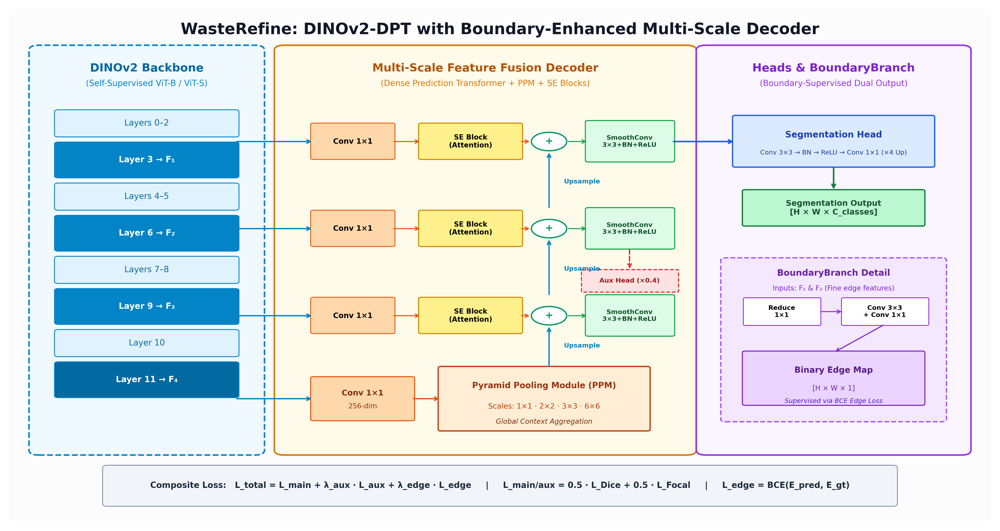
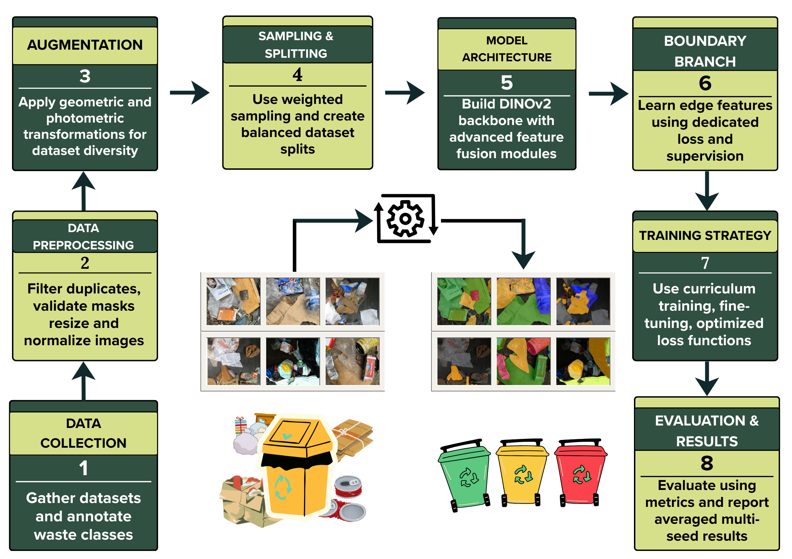
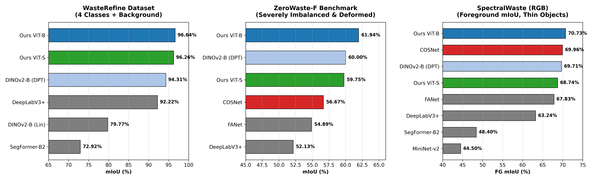
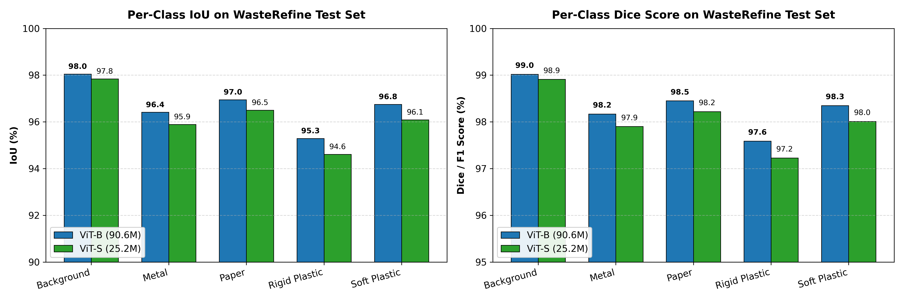
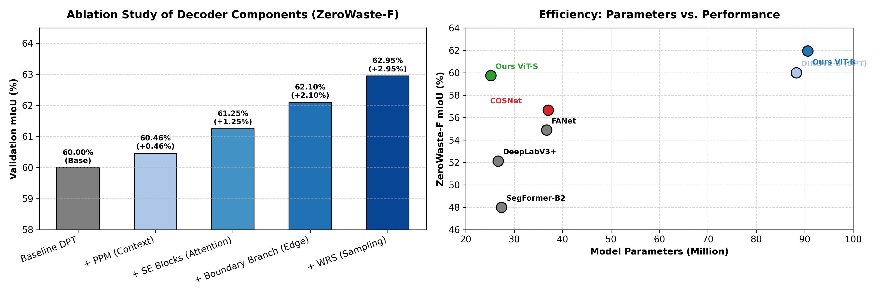
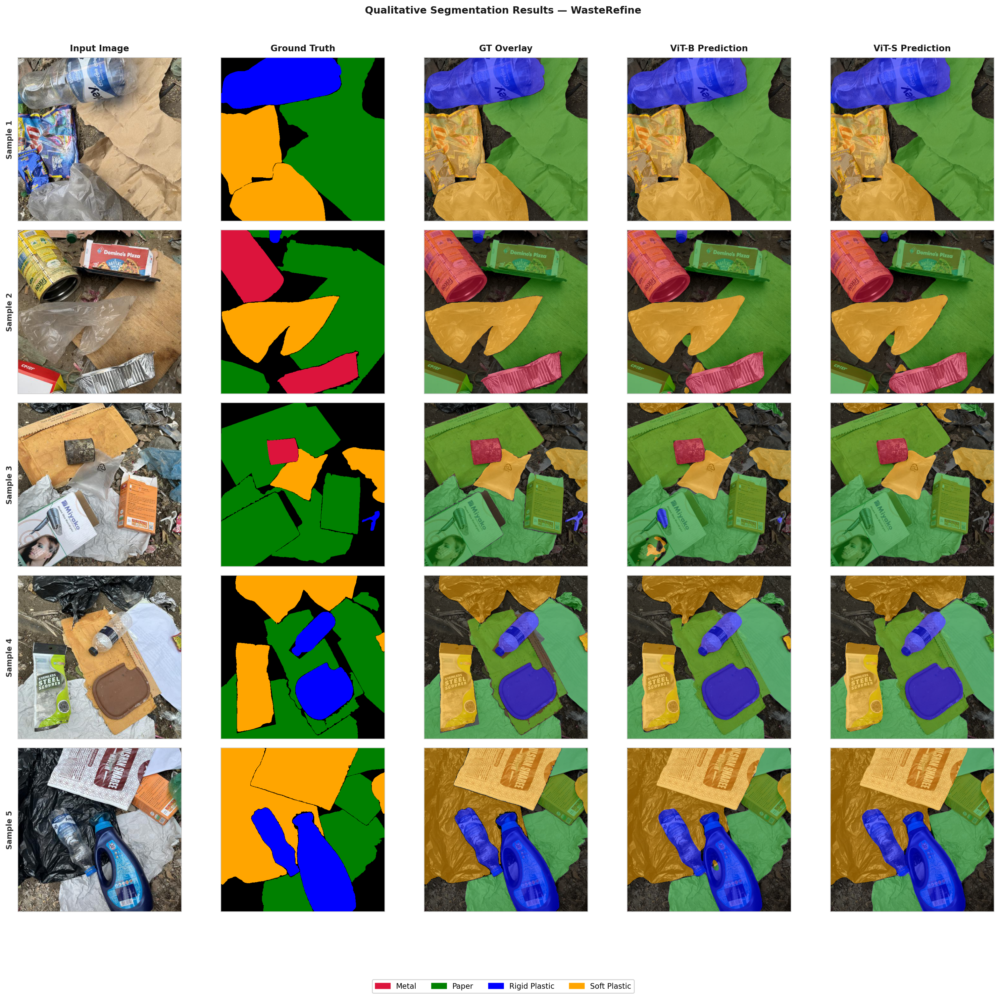
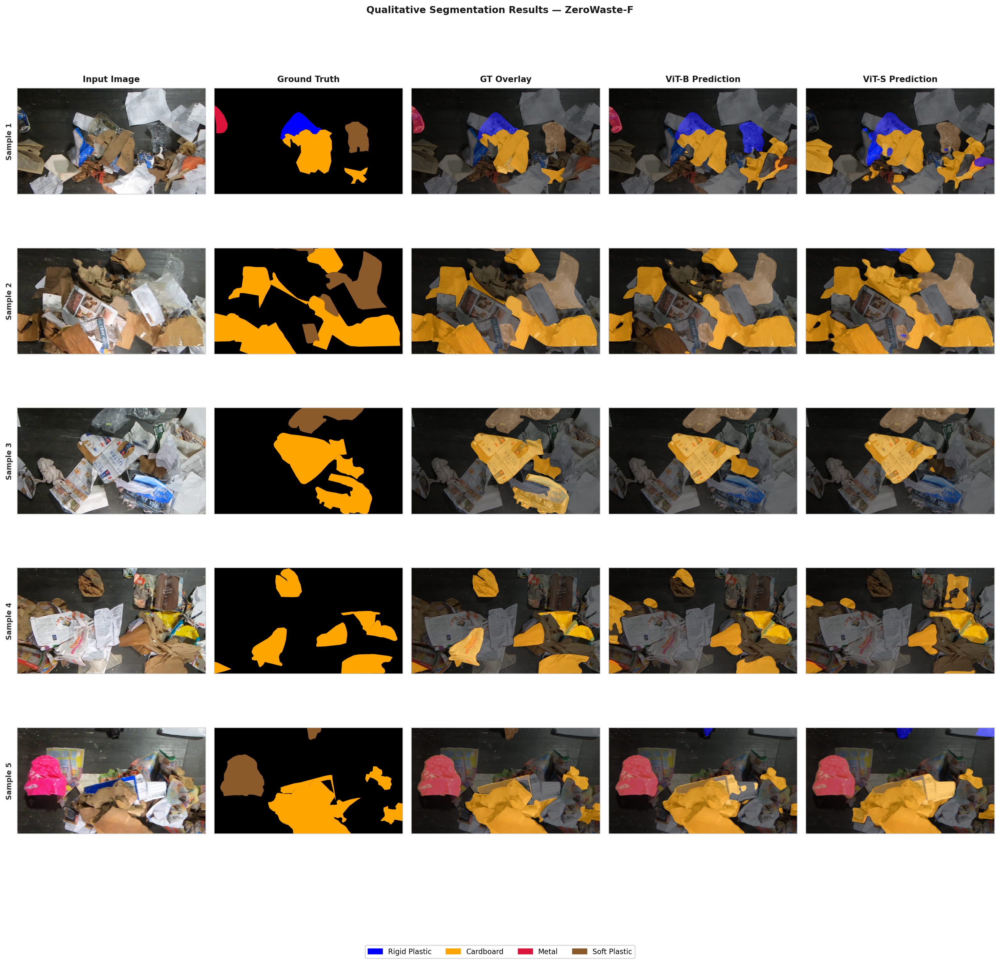
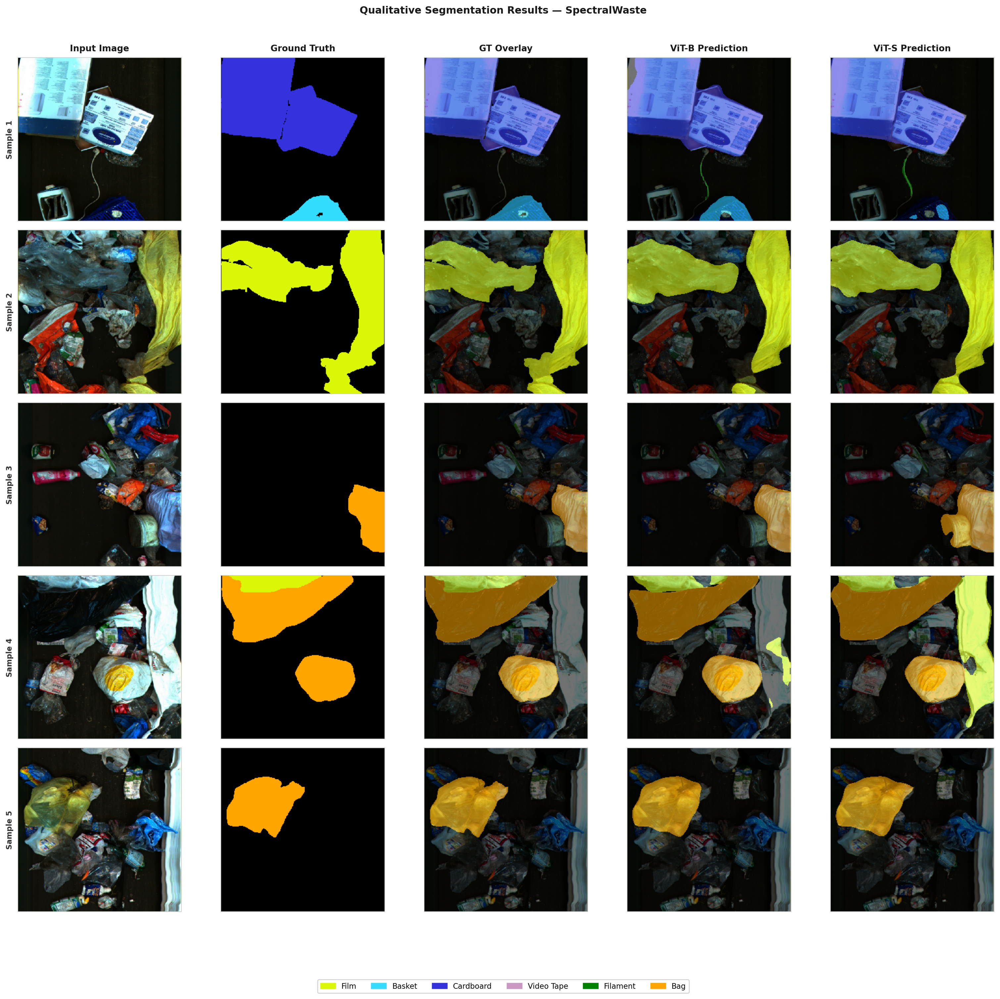

# WasteRefine: Boundary-Aware Semantic Segmentation of Waste Materials Using a DINOv2 Backbone with Multi-Scale Feature Fusion Decoder

[](https://github.com/)
[](RESEARCH_SUMMARY.md)
[](#license)
[](https://python.org)
[](https://pytorch.org)
[](https://universe.roboflow.com/talha-ljqb5/wasterefine)

---

## 📌 Overview

Automated waste sorting and intelligent recycling systems face significant bottlenecks due to visual ambiguities, severe class imbalance, deformed objects, and the scarcity of real-world annotated datasets. 

**WasteRefine** introduces:
1. **The WasteRefine Dataset**: The first dedicated real-world waste semantic segmentation dataset collected across diverse urban settings in Bangladesh (roadsides, dump yards, public dustbins), containing **2,213 precisely annotated images** and **10,860 object instances** across 4 foreground categories (*Paper, Soft Plastic, Rigid Plastic, Metal*).
2. **WasteRefine Architecture**: An object-aware semantic segmentation framework combining a self-supervised **DINOv2** Vision Transformer encoder (ViT-B / ViT-S) with a multi-scale dense prediction decoder equipped with:
   - **Pyramid Pooling Module (PPM)** for global contextual priors,
   - **Squeeze-and-Excitation (SE)** channel attention at every fusion stage,
   - **Boundary Enhancement Module (BoundaryBranch)** with edge supervision ($\mathcal{L}_{edge}$) to capture high-frequency contours and separate overlapping materials.

> **⚠️ Notice:** The paper is currently under peer review. Detailed source training/inference scripts and model weights will be released upon acceptance. For an executive overview of the project, abstract, and findings, please consult the [Research Summary Document](RESEARCH_SUMMARY.md).

---

## 🏗️ Methodology & Architecture

The framework extracts multi-scale intermediate feature maps ($F_1, F_2, F_3, F_4$) from DINOv2 layers 3, 6, 9, and 11, feeding them into a top-down feature fusion decoder alongside boundary supervision.

<p align="center">
  
</p>
<p align="center"><em>Figure 1: WasteRefine architecture consisting of DINOv2 backbone, Decoder with PPM + SE blocks, and the dedicated BoundaryBranch for edge-guided boundary refinement.</em></p>

### Composite Training Objective
The model is supervised end-to-end using a composite objective:
$$\mathcal{L}_{total} = \mathcal{L}_{main} + \lambda_{aux}\mathcal{L}_{aux} + \lambda_{edge}\mathcal{L}_{edge}$$
Where:
- $\mathcal{L}_{main/aux} = 0.5 \mathcal{L}_{Dice} + 0.5 \mathcal{L}_{Focal}$
- $\mathcal{L}_{edge} = \mathcal{L}_{BCE}(E_{pred}, E_{gt})$
- $\lambda_{aux} = 0.4$, $\lambda_{edge} = 0.20$ (or $0.15$ for ViT-S)

---

## 📊 Datasets

<p align="center">
  
</p>
<p align="center"><em>Figure 2: Representative sample images and annotations from the WasteRefine dataset.</em></p>

| Dataset | Images | Classes | Foreground Categories | Focus / Challenge |
|---------|:------:|:-------:|-----------------------|-------------------|
| **WasteRefine (Ours)** | 2,213 | 5 | Soft Plastic, Rigid Plastic, Paper, Metal | Real-world cluttered urban scenes (Bangladesh) |
| **ZeroWaste-F** | 4,503 | 5 | Rigid Plastic, Soft Plastic, Metal, Cardboard | Severe class imbalance & extreme deformation |
| **SpectralWaste (RGB)** | 852 | 7 | Film, Basket, Cardboard, Video Tape, Filament, Bag | Thin, visually ambiguous objects |

---

## 📈 Quantitative Results & Analysis

Experiments were evaluated across 3 independent random seeds. All reported results show mean $\pm$ standard deviation.

### 1. Benchmark Comparison Across Three Datasets

<p align="center">
  
</p>
<p align="center"><em>Figure 3: Benchmark comparison of WasteRefine (ViT-B and ViT-S) against published state-of-the-art baselines across WasteRefine, ZeroWaste-F, and SpectralWaste (RGB).</em></p>

| Model | Params | WasteRefine mIoU (%) ↑ | ZeroWaste-F mIoU (%) ↑ | SpectralWaste FG mIoU (%) ↑ |
|:------|:------:|:----------------------:|:----------------------:|:---------------------------:|
| SegFormer-B2 | 27.35M | 72.92% | — | 48.40% |
| MiniNet-v2 | — | — | — | 44.50% |
| DeepLabV3+ | 26.68M | 92.22% | 52.13% | 63.24% |
| FANet | 36.70M | — | 54.89% | 67.83% |
| COSNet | 37.00M | — | 56.67% | 69.96% |
| DINOv2-B + Linear Probe | 86.58M | 79.77% | — | — |
| DINOv2-B + Simple DPT | 88.25M | 94.31% | 60.00% | 69.71% |
| **WasteRefine ViT-S (Ours)** | **25.16M** | **96.26 ± 0.07%** | **59.75 ± 0.75%** | **68.74 ± 0.32%** |
| **WasteRefine ViT-B (Ours)** | **90.61M** | **96.64 ± 0.16%** | **61.94 ± 0.84%** | **70.73 ± 0.10%** |

*Note: SpectralWaste evaluates Foreground mIoU (FG mIoU, excluding background); ZeroWaste-F and WasteRefine report full macro mIoU.*

---

### 2. Per-Class Analysis on WasteRefine

<p align="center">
  
</p>
<p align="center"><em>Figure 4: Per-class IoU and Dice scores on the WasteRefine test set for ViT-B and ViT-S variants.</em></p>

| Class | ViT-B IoU | ViT-B Dice | ViT-B Prec. | ViT-B Acc. | ViT-S IoU | ViT-S Dice | ViT-S Prec. | ViT-S Acc. |
|:------|:---------:|:----------:|:-----------:|:----------:|:---------:|:----------:|:-----------:|:----------:|
| Background | 0.9805 | 0.9902 | 0.9915 | 0.9888 | 0.9784 | 0.9891 | 0.9916 | 0.9865 |
| Metal | 0.9641 | 0.9817 | 0.9822 | 0.9812 | 0.9589 | 0.9790 | 0.9770 | 0.9811 |
| Paper | 0.9695 | 0.9845 | 0.9823 | 0.9867 | 0.9650 | 0.9822 | 0.9789 | 0.9855 |
| Rigid Plastic | 0.9529 | 0.9759 | 0.9702 | 0.9817 | 0.9461 | 0.9723 | 0.9671 | 0.9775 |
| Soft Plastic | 0.9675 | 0.9835 | 0.9840 | 0.9830 | 0.9609 | 0.9801 | 0.9774 | 0.9828 |
| **Overall** | **0.9669** | **0.9832** | **0.9820** | **0.9843** | **0.9619** | **0.9805** | **0.9784** | **0.9846** |

---

### 3. Ablation Study & Parameter Efficiency

<p align="center">
  
</p>
<p align="center"><em>Figure 5: (Left) Progressive ablation improvements of decoder modules (PPM, SE, BoundaryBranch, WRS) on ZeroWaste-F (+2.95% total mIoU gain). (Right) Parameter count vs. segmentation accuracy scatter plot highlighting ViT-S efficiency (25.16M params).</em></p>

#### Ablation of Decoder Components (ZeroWaste-F)

| Configuration | PPM | SE | Boundary Branch | WRS | mIoU (%) ↑ | Δ Gain |
|:---|:---:|:---:|:---:|:---:|:---:|:---:|
| Baseline DPT | ✗ | ✗ | ✗ | ✗ | 60.00% | — |
| + PPM (Pyramid Pooling) | ✓ | ✗ | ✗ | ✗ | 60.46% | +0.46% |
| + SE (Channel Attention) | ✓ | ✓ | ✗ | ✗ | 61.25% | +1.25% |
| + Boundary Branch (Edge) | ✓ | ✓ | ✓ | ✗ | 62.10% | +2.10% |
| **+ WRS (Weighted Sampling)** | **✓** | **✓** | **✓** | **✓** | **62.95%** | **+2.95%** |

#### Per-Class IoU on Benchmark Datasets

| ZeroWaste-F Class | ViT-B | ViT-S | SpectralWaste Class | ViT-B | ViT-S |
|:---|:---:|:---:|:---|:---:|:---:|
| Background | 0.921 | 0.914 | Background | 0.939 | 0.930 |
| Rigid Plastic | 0.493 | 0.487 | Film | 0.795 | 0.789 |
| Soft Plastic | 0.625 | 0.607 | Basket | 0.821 | 0.817 |
| Metal | 0.415 | 0.350 | Cardboard | 0.850 | 0.826 |
| Cardboard | 0.694 | 0.652 | Video Tape | 0.380 | 0.365 |
| — | — | — | Filament | 0.677 | 0.640 |
| — | — | — | Bag | 0.717 | 0.704 |
| **Mean** | **0.6295** | **0.6019** | **FG Mean** | **0.7069** | **0.6900** |

---

## 🎨 Qualitative Results

Visual segmentation comparisons across all three benchmark datasets (Input Image, Ground Truth, GT Overlay, ViT-B Prediction, and ViT-S Prediction):

### 1. WasteRefine
<p align="center">
  
</p>

### 2. ZeroWaste-F
<p align="center">
  
</p>

### 3. SpectralWaste
<p align="center">
  
</p>

---

## 💻 Environment & Requirements

Dependencies are specified in [requirements.txt](requirements.txt). Key packages include:
- Python ≥ 3.10
- PyTorch ≥ 2.0
- torchvision ≥ 0.15.0
- transformers ≥ 4.30.0
- torchmetrics ≥ 1.0.0
- opencv-python, Pillow, matplotlib, tqdm

---

## 🔒 Code & Data Availability

- **Dataset:** [WasteRefine on Roboflow Universe](https://universe.roboflow.com/talha-ljqb5/wasterefine)
- **Model Checkpoints & Code:** Full source code, training configurations, and pre-trained weights will be made publicly available upon acceptance of the paper.

---

## 📝 Citation

If you find this work relevant to your research, please cite our paper:

```bibtex
@article{khan2026wasterefine,
  title   = {WasteRefine: Boundary-Aware Semantic Segmentation of Waste Materials Using a DINOv2 Backbone with Multi-Scale Feature Fusion Decoder},
  author  = {Talha Islam Khan and Trisha Das and Md. Ahnaf Iqbal and Farhan Tawseef and Nirjhor Datta and Md. Golam Rabiul Alam},
  journal = {Under Review},
  year    = {2026}
}
```

## 📬 Contact

For research inquiries or collaboration:  
- **Author:** [Md. Ahnaf Iqbal](mailto:md.ahnaf.iqbal@g.bracu.ac.bd)


---

## 📜 License

© 2026 Talha Islam Khan et al. All rights reserved.  
This repository is presented for academic portfolio and preprint reference purposes.

